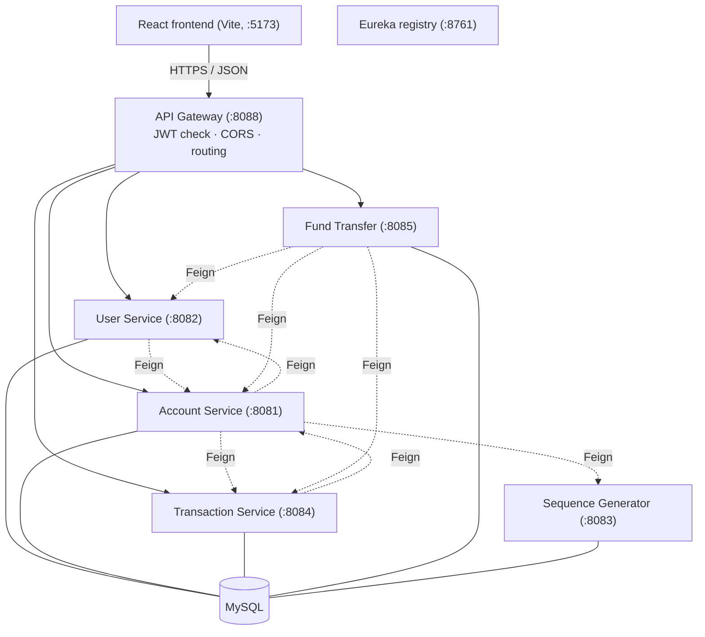

# Finexus

A personal banking app: a React frontend talking to Spring Boot microservices through an API gateway.

Users can register, hold savings and current accounts, deposit and withdraw, send money to other customers by account number or customer ID (e.g. `FIN2`), and search or export their transaction history.

[](https://openjdk.org/)
[](https://spring.io/projects/spring-boot)
[](https://react.dev/)
[](https://www.typescriptlang.org/)
[](https://tailwindcss.com/)
[](https://www.mysql.com/)

---

## Architecture



| Service | Port | Responsibility |
| :--- | :---: | :--- |
| **Service-Registry** | 8761 | Eureka service discovery |
| **API-Gateway** | 8088 | Single entry point. Validates the login token, blocks internal-only endpoints, handles CORS, routes requests |
| **User-Service** | 8082 | Registration, sign-in (issues JWTs), password change, profiles |
| **Account-Service** | 8081 | Accounts and balances. All balance changes are single atomic SQL updates |
| **Transaction-Service** | 8084 | Deposits, withdrawals and transaction history |
| **Fund-Transfer** | 8085 | Transfers between accounts |
| **Sequence-Generator** | 8083 | Account numbers (`ACC0000001`, …) |
| **Frontend** | 5173 | React 19 + TypeScript + Tailwind 4 + Zustand |

### Data

Each service owns its own tables, which Hibernate creates automatically (`ddl-auto=update`), so no manual schema is needed. By default all services point at **one** MySQL database (`MYSQL_DB_NAME`). To give each service its own database, run it with a different `MYSQL_DB_NAME`.

---

## Security model

- **Sign-in:** User-Service checks the password (stored as a BCrypt hash) and issues a JWT, valid for 24 hours, that carries the user's id.
- **Gateway:** every request except login and register must carry a valid token. The gateway removes any `X-Auth-User-Id` header the client sent and sets it from the verified token.
- **Ownership:** services only let you read or change your own accounts, transactions, transfers and profile.
- **Internal-only endpoints** used between services (balance changes, sequence numbers, user lookups) are refused at the gateway.
- **Money rules:** amounts must be positive. You can't transfer to the same account. Balances can't go below zero. Both sides of a transfer change in one database transaction. If saving the history fails, the money movement is reversed.

> The services trust the gateway's `X-Auth-User-Id` header, so in any real deployment **only the gateway may be reachable from outside**. Keep ports 8081–8085 private.

---

## Running it

### Prerequisites
- Java 17+ and Maven
- Node.js 20+ and npm
- MySQL 8 on port 3306, with an empty database created (e.g. `CREATE DATABASE finexus;`)

### 1. Configure

```bash
cp backend/.env.example backend/.env      # then edit it
cp frontend/.env.example frontend/.env
```

`backend/.env` needs your MySQL login and a `JWT_SECRET` (base64, at least 32 bytes). The example file shows how to generate one.

### 2. Start the backend

On Windows:
```bash
cd backend
start-services.bat
```
This loads `.env` and starts the registry, the gateway, then the services. Wait until all of them show on http://localhost:8761. `stop-services.bat` stops them.

On other systems, export the variables from `.env`, then run `mvn spring-boot:run` in `Service-Registry`, then `API-Gateway`, then each remaining service folder.

### 3. Start the frontend

```bash
cd frontend
npm install
npm run dev
```

Open http://localhost:5173. Registering creates your user and a savings account.

### Demo mode (no backend)

Set `VITE_USE_MOCK_DATA=true` in `frontend/.env` and sign in with `demo@finexus.com` / `password123`. The app then uses built-in sample data that follows the same rules as the backend. Changes reset when you reload the page.

---

## API (through the gateway, `http://localhost:8088`)

| Method | Route | Who | Description |
| :---: | :--- | :--- | :--- |
| POST | `/api/auth/register` | public | Create a user (and a savings account) |
| POST | `/api/auth/login` | public | Sign in, returns a JWT |
| POST | `/api/auth/change-password` | signed in | Change your password |
| GET / PUT | `/api/users/{id}` | own id | Read / update your profile |
| GET | `/accounts/user/{userId}` | own id | Your accounts |
| POST | `/accounts` | signed in | Open an account (starts at ₹0) |
| PUT | `/accounts/closure?accountNumber=` | owner | Close an empty account |
| GET | `/accounts?accountNumber=` | owner | One account |
| POST | `/transactions` | owner | `DEPOSIT` or `WITHDRAWAL` |
| GET | `/transactions?accountId=` | owner | Account history |
| POST | `/fund-transfers` | owner of `fromAccount` | Send money (`toAccount` may be an account number or `FIN…` ID) |
| GET | `/fund-transfers/{reference}` | sender or receiver | Transfer details |

---

## Tests

```bash
cd backend && mvn test          # money rules, gateway security, sign-up validation
cd frontend && npm test         # utilities, account selection, demo-mode rules
```

Backend tests are plain unit tests (JUnit + Mockito) and don't need MySQL or a running registry.

---

## Project layout

```
backend/
  API-Gateway/  Service-Registry/  User-Service/  Account-Service/
  Transaction-Service/  Fund-Transfer/  Sequence-Generator/
  start-services.bat  stop-services.bat  .env.example
frontend/
  src/pages/        app and public pages
  src/components/   layout and UI building blocks
  src/services/     API calls (+ mock/ for demo mode)
  src/store/        Zustand state
```
